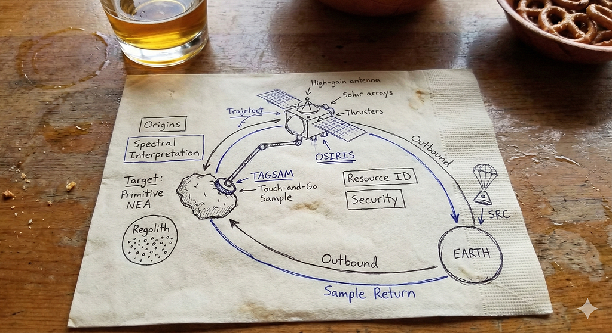
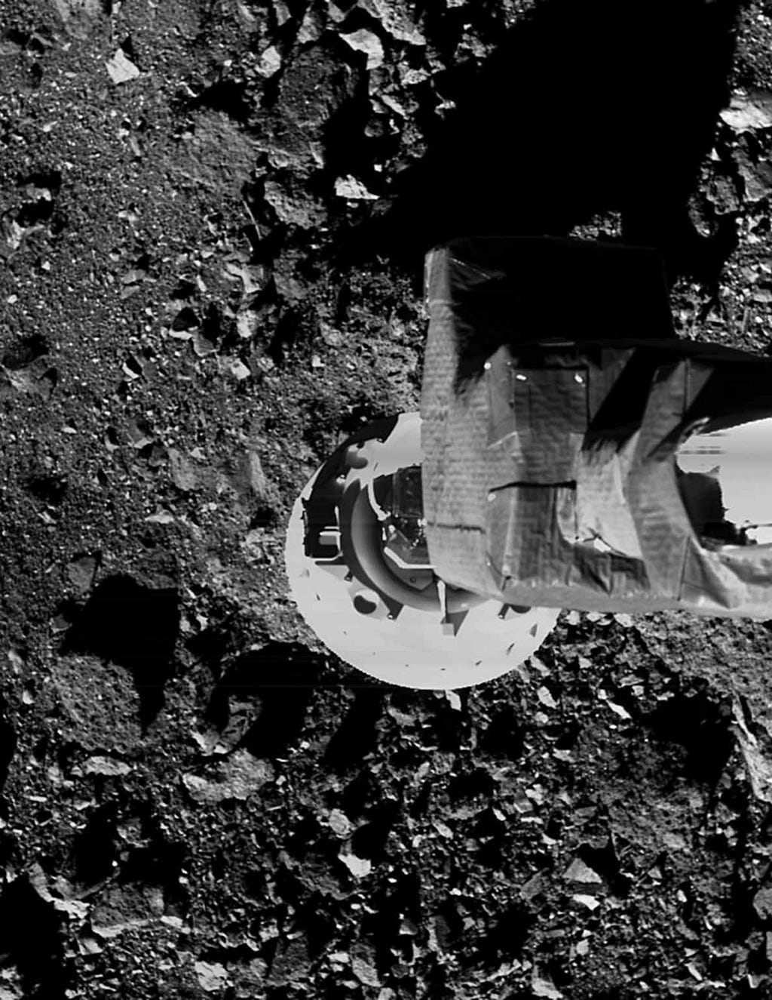
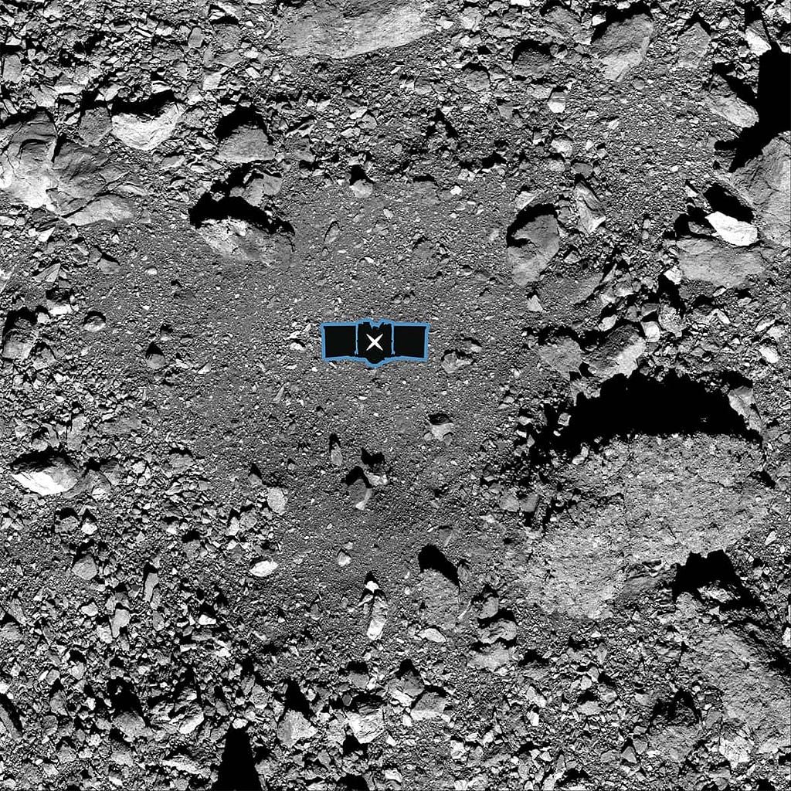
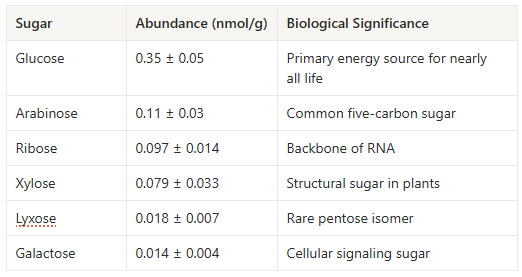


<h2 id="a-napkin-a-bar-and-a-plan-to-invade-a-space-asteroid">A napkin, a bar, and a plan to invade a space asteroid</h2>
The origin of NASA’s OSIRIS-REx spacecraft mission was born in 2004, when two planetary scientists and an engineer sat in a Tucson bar, a short walk from the University of Arizona campus. Michael Drake, who had spent a career thinking about “Did asteroids seed early Earth with the molecules needed to start biology?” while he sat across young Dante Lauretta and Lockheed Martin engineer Steve Price.

On that cocktail napkin, the three sketched the mission concept Drake wanted to pitch to NASA. Lauretta gave it the name <strong>OSIRIS (Origins, Spectral Interpretation, Resource Identification, and Security).</strong> The first attempt failed immediately. Reviewers dismissed it as they haven’t yet identified a specific asteroid to target. They reworked the plan, only to be rejected again, this time for being too ambitious and too expensive.
<figure><figcaption>A hypothetical visualization of the napkin sketch</figcaption></figure>
Instead of shrinking the idea, they expanded it. The mission grew in scope and in name. OSIRIS became <strong>OSIRIS-REx, with “Regolith Explorer”.</strong> A regolith is the loose, dusty mix of gravel, powder, and shattered rock found on the surface of an asteroid. The mission no longer aimed to just study an asteroid from orbit. It committed to penetrating the surface environment, characterizing the mineralogy, mapping the chemistry with high-precision instruments and extracting a physical sample of primitive regolith for return to Earth. In 2011, after years of work, NASA finally said yes.
<h2 id="why-bother-spending-a-billion-dollars-to-grab-a-handful-of-a">Why bother spending a billion dollars to grab a handful of asteroid dust when thousands of meteorites fall to Earth every day?</h2>
The famous Murchison meteorite that fell in Australia in 1969, carried more than seventy amino acids, but it was contaminated by atmospheric entry heating, weathering, and exposure to terrestrial microbes, making it impossible to know with certainty which molecules were truly extraterrestrial. Therefore, the only was to fly to a primitive asteroid, scoop untouched material, and bring it home before Earth touched it.
<h2 id="but-why-bennu-became-the-chosen-one">But why Bennu became the chosen one?</h2><ul><li><strong>Proximity and accessibility :</strong>The mission required an asteroid whose orbit closely matched Earth’s low eccentricity and inclination to minimize fuel costs and travel time. At the time of selection in 2008, only <strong>192 of approximately 7,000 known near-Earth objects</strong> met these orbital criteria.</li><li><strong>Size and rotation: </strong>Asteroids smaller than 200 meters diameter spin so rapidly they throw their regolith into space, leaving no surface material to sample. This requirement reduced candidates from 192 to just <strong>26 asteroids.</strong></li><li><strong>Composition: </strong>Primitive, carbon-rich asteroids that have barely changed since the Solar System formed 4.5 billion years ago. These B- and C-type bodies are the ones loaded with organics, volatiles, and amino acids. Of the 26 remaining candidates, only <strong>12 had known compositions, and only 5 were primitive and carbon-rich</strong>.</li></ul>
Asteroid (101955) <strong>Bennu</strong> was the final choice. Discovered in 1999 by the Lincoln Near-Earth Asteroid Research (LINEAR) survey, it’s a 490-meter rubble pile that revolves around the Sun every 436 days and passes near Earth every six years. Also, it has a small but real chance of hitting Earth on September 24, 2182 (roughly 1 in 2,700 odds).
<figure><figcaption>Asteroid Bennu during OSIRIS-REx sample</figcaption></figure><h2 id="the-journey-seven-years-to-touch-an-asteroid">The Journey: Seven Years to Touch an Asteroid</h2>
OSIRIS-REx launched from Cape Canaveral on <strong>September 8, 2016</strong>, aboard an Atlas V rocket and arrived at Bennu on <strong>December 3, 2018.</strong>

Bennu looked nothing like the pre-launch models. Instead of smooth sands, the asteroid was full of huge rocks and boulders, everywhere. Bennu was actively ejecting particles into space and the asteroid’s surface was so loosely packed, it was a quicksand so landing wasn’t an option so the team used a device called <strong>TAGSAM </strong>(<strong>Touch-and-Go Sample Acquisition Mechanism), a 11-foot arm with a circular collection head that would contact the asteroid surface, release high-pressure nitrogen gas to fluidize loose material, and capture regolith instantly.</strong>
<iframe src="https://cdn.embedly.com/widgets/media.html?src=https%3A%2F%2Fwww.youtube.com%2Fembed%2FKan0FIjjjQw%3Ffeature%3Doembed&amp;display_name=YouTube&amp;url=https%3A%2F%2Fwww.youtube.com%2Fwatch%3Fv%3DKan0FIjjjQw&amp;image=https%3A%2F%2Fi.ytimg.com%2Fvi%2FKan0FIjjjQw%2Fhqdefault.jpg&amp;type=text%2Fhtml&amp;schema=youtube" width="854" height="480" frameborder="0" scrolling="no"><a href="https://medium.com/media/cbb8691c3a5947524660c576a14d332a/href">https://medium.com/media/cbb8691c3a5947524660c576a14d332a/href</a></iframe>
On <strong>October 20, 2020</strong>, after nearly two years of surface mapping of the asteroid, the spacecraft touched Bennu for only <strong>five seconds,</strong> just long enough to fire its nitrogen burst and collect regolith before thrusting away.
<figure><figcaption>NASA’s OSIRIS-REx Successfully Touches Asteroid Bennu</figcaption></figure>
The return capsule landed in Utah on 24 September 2023 with <strong>121.6 grams</strong> of asteroid dust, the largest extraterrestrial sample returned since the Apollo missions.
<h2 id="the-chemistry-of-stardust">The Chemistry of Stardust</h2>
From one 603-mg portion of homogenized Bennu powder, researchers lead by <strong>Yoshihiro Furukawa</strong> at Tohoku University began the slow extraction of organics.

The extraction protocol was carefully designed to prevent sugar formation or degradation during analysis. The team used <strong>2% HCl acid extraction</strong> because sugar-forming reactions are suppressed at low pH. The extracted material underwent:
<ol><li><strong>Sonication extraction</strong> in acid solution (30 minutes, under 25°C)</li><li><strong>Water extraction</strong> of residues</li><li><strong>Methanol purification</strong></li><li><strong>Cation exchange chromatography</strong> to remove interfering ions</li><li><strong>Derivatization</strong> into aldonitrile acetates (chemically modified forms easier to detect via gas chromatography)</li></ol>
Gas chromatography–tandem mass spectrometry (GC-MS/MS) was the core tool. The asteroid dust were vaporized, pushed through a chromatography column, and separated by how fast they moved, each one has its own retention time. As they exited the column, the mass spectrometer shattered them into fragments. The resulting <strong>mass-to-charge (m/z) ratios</strong> create a unique “fingerprint” for each compound.

For pentose sugars, the team monitored five characteristic fragment masses. For hexose sugars, they monitored six fragments. That’s how ribose, glucose, arabinose, xylose, lyxose, and galactose were confirmed in Bennu. <strong>One sugar was conspicuously absent: 2-deoxyribose, the backbone of DNA.</strong> Its absence makes chemical sense. Deoxyribose is chemically fragile; it would have been rapidly consumed by reactions with other molecules during the asteroid’s 4.5-billion-year history.
<figure><figcaption>The table shows Abundance of Sugars Detected in Bennu Samples</figcaption></figure>
Bennu sample analysis found all five canonical nucleobases (adenine, guanine, cytosine, thymine, and uracil), phosphates, and 14 amino acids i.e. <strong>Bennu carried the ingredients for RNA, not DNA.</strong>
<h2 id="how-did-sugars-originate-in-an-asteroid">How did sugars originate in an asteroid?</h2>
The leading hypothesis involves the formose reaction, a chemical process first described by Russian chemist Alexander Butlerov in 1861.

In this reaction, formaldehyde (CH₂O) molecules undergo sequential addition reactions:
<pre>2 CH2O → C2H4O2 (glycolaldehyde)  C2H4O2 + CH2O → C3H6O3 (glyceraldehyde)</pre>
This process continues iteratively, building larger sugars from smaller ones. The reaction becomes <strong>autocatalytic</strong>; products of the reaction catalyze further reactions, accelerating sugar formation.

Evidence for formose-style sugar formation inside Bennu’s parent body is strong:

• <strong>Aldehydes present:</strong> Formaldehyde and related precursors were detected.  • <strong>Alkaline conditions:</strong> Bennu extracts show pH ~8.2, ideal for formose chemistry.  • <strong>Catalysts available:</strong> Calcium and magnesium carbonates promote sugar formation, Bennu contains abundant of it.  • <strong>Water-rock interaction:</strong> Phyllosilicates indicate Bennu’s parent body experienced a lot of water-rock interactions.  • <strong>Sugar patterns match:</strong> Bennu’s pentose distribution mirrors lab formose products.
<h2 id="supporting-the-rna-world-hypothesis">Supporting the RNA World Hypothesis</h2>
Life first relied on RNA. Unlike DNA, RNA can both <strong>store genetic information</strong> and <strong>catalyze chemical reactions</strong> (as ribozymes) even before proteins were evolved.

The Bennu findings support this in several ways:
<ul><li><strong>Ribose present, deoxyribose absent</strong>: The building block of RNA was available; the building block of DNA was not</li><li><strong>All five nucleobases detected</strong>: The complete genetic alphabet for both RNA and DNA exists in Bennu</li><li><strong>Widespread distribution</strong>: If Bennu is representative of carbonaceous asteroids, these molecules were common throughout the early solar system</li></ul><h2 id="space-gum-and-stardust">“Space Gum” and “Stardust”</h2>
A team of NASA Ames discovered a <strong>gum-like polymer material</strong> never before seen in astromaterials. A nitrogen- and oxygen-rich polymer, originally flexible but now hardened, formed through <strong>carbamate polymerization</strong> when ammonia and carbon dioxide reacted on hot Bennu’s surface. This could be a chemical precursors for life’s emergence

Secondly, another team at NASA Johnson Space Center found that Bennu samples contain <strong>six times more supernova dust</strong> than any previously studied astromaterial. This suggest that <strong>Bennu’s parent is older than the solar system itself.</strong>
<h2 id="the-story-isn-t-over">The story isn’t over</h2>
Only a fraction of the 121.6 grams has been analyzed so far. NASA curators are distributing portions to laboratories worldwide, and the majority of the sample is being preserved for future generations until better instruments exist.

Meanwhile, the spacecraft itself continues exploring. Renamed <strong>OSIRIS-APEX</strong>, it’s now en route to asteroid <strong>(99942) Apophis</strong>, which will make an exceptionally close Earth flyby in 2029. Scientists hope to study how gravitational tides from that close approach affect the asteroid’s surface

if you love reading about biotech x AI, follow me on twitter/X <a href="https://x.com/TensorTwerker">@TensorTwerker</a> : I share insights on protein modeling, computational biology, and the occasional chaos that happens in my life.


