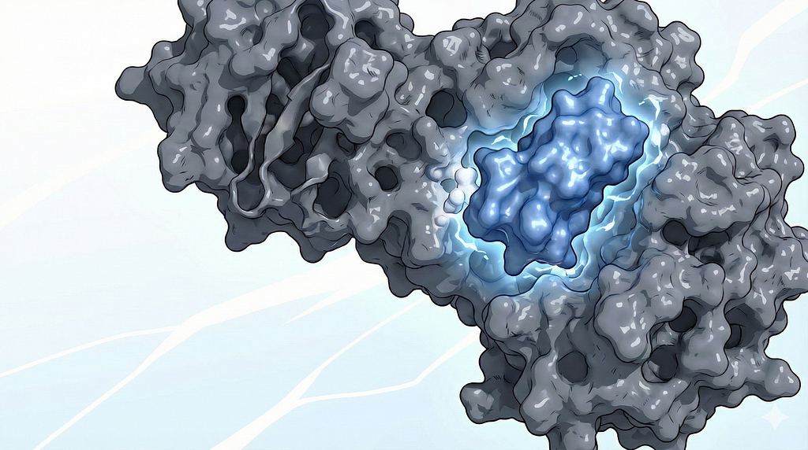
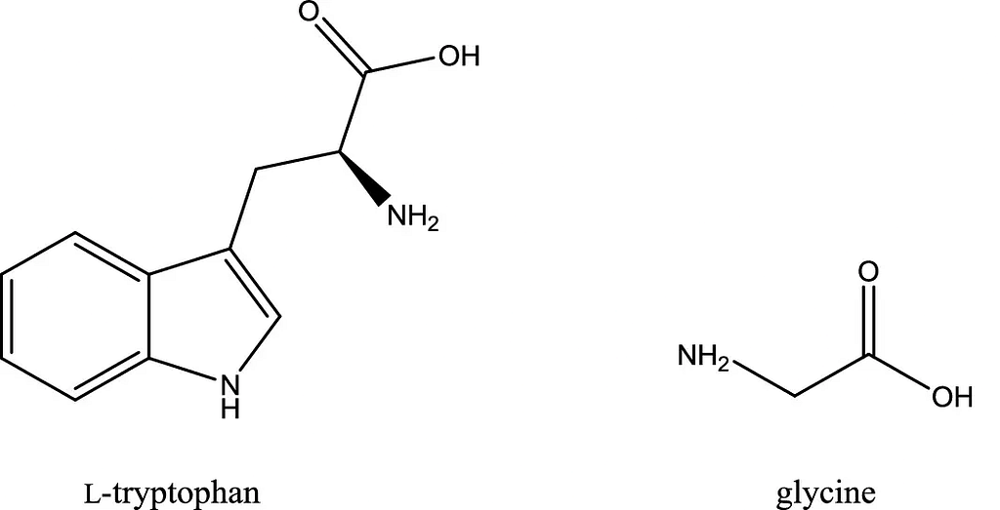
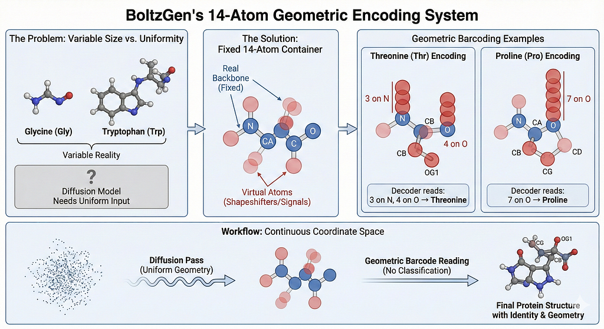
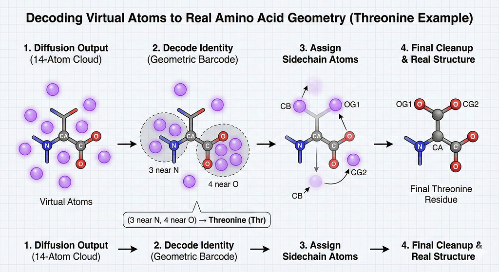
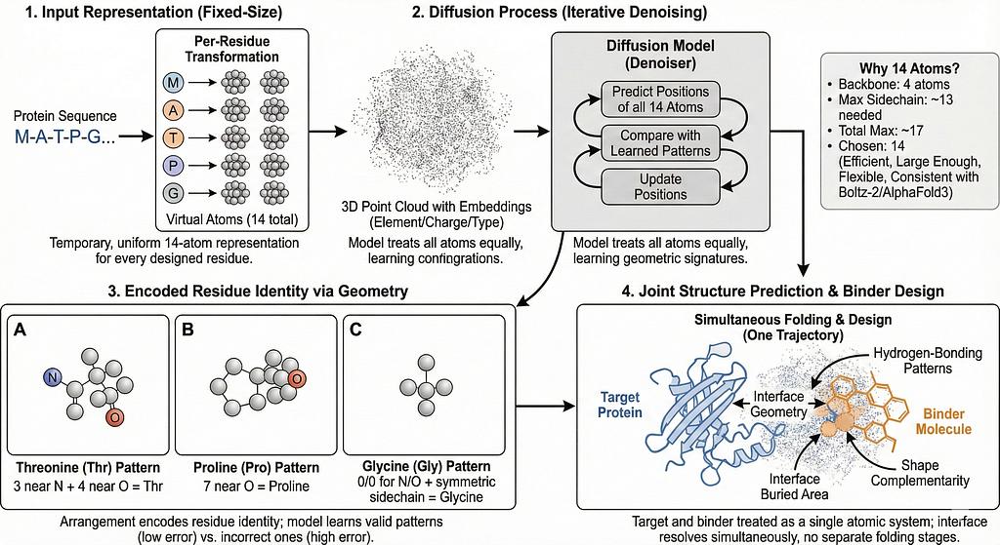
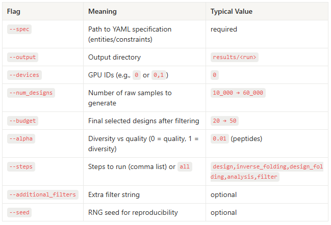
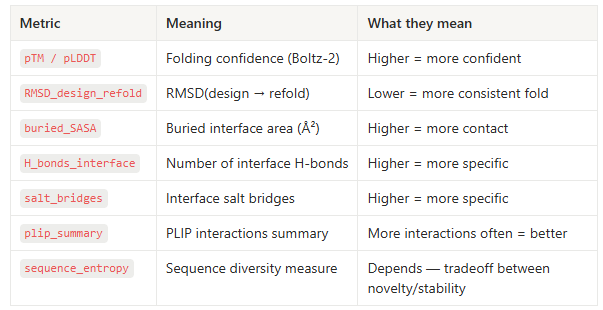
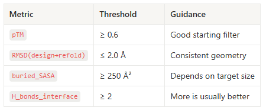


<figure></figure>
<strong>BoltzGen</strong>, a new diffusion model that generates <em>de novo </em>molecules from scratch which binds to other proteins, peptides, nanobodies, disulfide-cyclized peptides, helicons, cyclic peptides, and protein binders for small molecules, nucleic acids, disordered regions, and folded protein targets. That’s why it’s called an <strong>universal binder</strong>. It consists of:
<ul><li><strong>BoltzGen</strong> (the diffusion model which generates <em>de novo</em> structures)</li><li><strong>BoltzIF</strong> (for inverse folding, <em>given this fold, what sequence would actually stabilize it?)</em></li><li><strong>Boltz-2</strong> it refolds the designed sequence, checks whether the structure holds together, estimates binding affinity, and evaluates interface quality through buried surface area, hydrogen bonds etc.)</li></ul>
BoltzGen doesn’t treat proteins as tokens like Large Language Models. It treats them as physical objects that only make sense in three dimensions as amino acid residues are in certain order and folded in 3D space.

<strong>So how did they solve it?</strong>
<h2 id="14-atoms-representation">14 atoms representation</h2>
Amino acids has different size and shapes. Glycine barely has a sidechain at all. Tryptophan has a large aromatic component. Diffusion models don’t like that chaos.
<figure></figure>
When BoltzGen is <em>designing</em> a residue, it doesn’t yet know whether that position will become an Alanine or a Threonine. Each amino acid has a different number of atoms, from 1–20 atoms on its sidechain. <strong>That’s the problem, the model needs a fixed-size structure</strong> (same number of atoms every time), otherwise you can’t diffuse coordinates in a consistent vector space.

<strong>BoltzGen’s solution:</strong>

Each designed residue is temporarily represented using <strong>exactly 14 atoms</strong>, regardless of which amino acid it will eventually become.
<ul><li>4 atoms are <em>real</em> backbone atoms: <strong>N, CA, C, O</strong></li><li>The remaining <strong>10 atoms are “virtual” placeholders</strong>. The model signals which amino acid it wants by placing a specific number of these virtual atoms directly onto the backbone atoms (on top of <strong>N</strong> and <strong>O</strong>). Then it decode the amino acid identity by counting how many virtual atoms land on each backbone position (within 0.5 Å).</li></ul>
After generation finishes:
<ul><li>virtual atoms are discarded</li><li>a real amino acid identity is decoded from their positions</li></ul><figure></figure><h2 id="how-the-model-actually-turns-the-14-atom-placeholder-into-th"><strong>How the model actually turns the 14-atom placeholder into the final real amino acid geometry?</strong></h2>
Diffusion is a cloud, once the model finish diffusion, it has 14 residues as I have mentioned earlier. The system has to translate that cloud into: a real amino acid with a real sidechain which doesn’t break chemistry. Let’s understand this with Threonine example:

Each amino acid has a unique pattern like a barcode. Threonine is encoded by placing <strong>3</strong> virtual atoms on the <strong>backbone nitrogen</strong>, and <strong>4</strong> virtual atoms on the <strong>backbone oxygen</strong>.
<ul><li>Fixed atoms (backbone) which always exists: N,CA, C, O</li><li>Virtual atoms (atoms 5–14)</li><li>BoltzGen needs to signal the residue identity using atoms 5–14</li></ul>
So the threonine encoding looks like:
<pre>N atom:   N + 3 virtual atoms CA atom:  (just CA) C atom:   (just C) O atom:   O + 4 virtual atoms Sidechain: 3 atoms left → CB, OG1, CG2</pre>
For threonine, check how many virtual atoms are within 0.5 Å of:
<ul><li><strong>3 virtual atoms placed exactly on top of the N atom</strong></li><li><strong>4 virtual atoms placed exactly on top of the O atom</strong></li><li><strong>Remaining 3 virtual atoms</strong> become real sidechain atoms (CB, OG1, CG2) where CB = beta carbon; OG1 = hydroxyl oxygen branch; CG2 = second carbon branch of threonine’s side chain.</li></ul><figure></figure>
Diffusion doesn’t guarantee perfect bond lengths or ideal chirality, so the model runs a local cleanup pass where bonds are corrected, angles restored to restore chemistry.
<h2 id="how-the-diffusion-process-works"><strong>How the Diffusion Process Works?</strong></h2>
Diffusion models can only operate on <strong>fixed-size representations</strong>. As I have discussed above, BoltzGen solves this by giving every <em>designed</em> residue a temporary, uniform 14-atom representation.

<strong>Diffusion treats all atoms equally i.e.</strong> the diffusion model sees just a cloud of 3D points with element/charge/type embeddings. It doesn’t know which atoms are virtual; that’s only used in decoding afterward. With iterative denoising:
<ul><li>the denoiser predicts the positions of all 14 atoms</li><li>their arrangement will encode residue identity via geometry</li><li>the denoiser learns the patterns that correspond to valid amino acids</li></ul><h2 id="why-virtual-atoms-encode-residue-identity-so-effectively">Why virtual atoms encode residue identity so effectively?</h2>
During training, the model repeatedly encounters the same geometric signatures that distinguish one amino acid from another.
<ul><li><strong>“3 near N + 4 near O = Threonine”</strong></li><li><strong>“7 near O = Proline”</strong></li><li><strong>“0/0 for N/O + symmetric sidechain = Glycine”</strong></li></ul>
These configurations repeatedly appear in real proteins. The diffusion model learns that reproducing them reduces structural error, incorrect patterns (wrong amino acids) increase the <strong>Mean Squared Error (</strong>MSE) and <strong>local Distance Difference Test (</strong>lDDT) errors. As a result, it naturally produces these patterns during generation.
<h2 id="but-why-14-atoms-why-not-10-or-20">But why 14 atoms? Why not 10 or 20?</h2>
Simply, to support the largest residues without running out of space, you need:
<pre>Backbone: 4 atoms Max sidechain atoms needed: 13 Total theoretical max = 17</pre>
Thus <strong>14 atoms</strong> is:
<ul><li>small enough to be computationally efficient</li><li>large enough to represent the largest residues</li><li>flexible enough for geometric encoding patterns</li><li>consistent with Boltz-2 and AlphaFold3 architecture constraints</li></ul><h2 id="why-this-representation-enables-better-structure-prediction-"><strong>Why this representation enables better structure prediction and binder design?</strong></h2>
A single, continuous representation means BoltzGen never has to switch modes when the task changes. Every proteins, peptides, nucleic acids, small molecules enters the model as same type of object: an all-atom point cloud.

Most importantly, binders and targets are folded together because the model treats them as a single atomic system. It does not fold the target first and design the binder afterward, it resolves both simultaneously through one diffusion trajectory. Interface geometry, hydrogen-bonding patterns, shape complementarity, and buried area all emerge from the same process.
<figure></figure><h2 id="boltzgen-protocols">BoltzGen Protocols</h2>
There are four protocols:
<ul><li>protein-anything for designing proteins to bind protein/peptide targets</li><li>peptide-anything for designing peptides to bind protein targets</li><li>protein-small molecule for designing proteins to bind small molecules</li><li>nanobody-anything for designing nanobodies</li></ul>
Below protocol is focused, practical guide to run <strong>peptide-anything</strong> on an HPC cluster so anyone can reproduce, tune, and inspect results. It covers YAML examples, key CLI flags, recommended settings, HPC tips, what the outputs mean, and minimal troubleshooting.

BoltzGen samples 3D all-atom structures with virtual placeholders, converts them to sequences (BoltzIF), refolds and scores them (Boltz-2), then ranks/filter designs — peptide-anything constrains the design to short peptide binders.
<h2 id="typical-pipeline-steps-seven-logical-stages">Typical pipeline steps (seven logical stages)</h2><ol><li><strong>Design</strong> : diffusion generation of candidate binder structures (BoltzGen core).</li><li><strong>Inverse folding</strong> : generate sequences (BoltzIF).</li><li><strong>Design folding</strong> : refold binder+target to validate interface (Boltz-2).</li><li><strong>Folding :</strong> refold binder alone (for stability; often skipped for short peptides).</li><li><strong>Affinity:</strong> (optional for small molecules) estimate affinity.</li><li><strong>Analysis :</strong> compute interface metrics (buried SASA, H-bonds, salt bridges, plip).</li><li><strong>Filtering :</strong> rank and select diverse, high-quality candidates.</li></ol>
You can run all stages or any subset. For peptides you typically run: design → inverse_folding → design_folding → analysis → filter

Folding-alone can be skipped for very short peptides or nanobodies (default for peptide-anything).

<strong>Table 1: Key CLI flags</strong>
<figure></figure>
<strong>Table 2: Common output metrics</strong>
<figure></figure>
Notes:
<ul><li><strong>pTM/pLDDT</strong> from Boltz-2 are primary confidence metrics. Use <strong>higher</strong> values for initial triage</li><li><strong>RMSD(design → refold)</strong> close to zero indicates the sequence refolds to the designed geometry, <strong>lower</strong> is better.</li></ul>
<strong>Table 3: Design Quality Thresholds</strong>
<figure></figure><h2 id="minimal-recommended-settings-for-a-first-peptide-run">Minimal recommended settings for a first peptide run</h2><ul><li>protocol: peptide-anything</li><li>num_designs: <strong>10,000</strong> (start small) → scale to 30–60k for production.</li><li>budget: <strong>20–50</strong> (final candidates)</li><li>alpha: <strong>0.01</strong> (peptide default)</li><li>steps: design,inverse_folding,design_folding,analysis,filter</li><li>GPUs: ≥16 GB recommended to start; distribute -num_designs across jobs on HPC</li></ul><h2 id="conclusion">Conclusion</h2>
BoltzGen works the way structural biology actually works: geometry first. It forces the model to justify every atom, then keeps only the sequences that survive folding, refolding, and the usual structural abuse. Diffusion, inverse folding, and refolding lock together into a single, compact engine that has the leverage to become the baseline for reliable structure generation.

if you love reading about biotech x AI, follow me on twitter/X <a href="https://x.com/TensorTwerker">@TensorTwerker</a> : I share insights on protein modeling, computational biology, and the occasional chaos that happens in my life.


