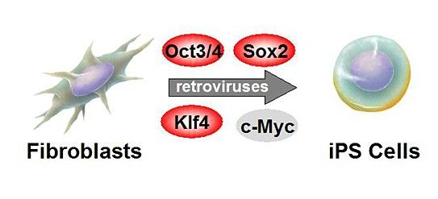
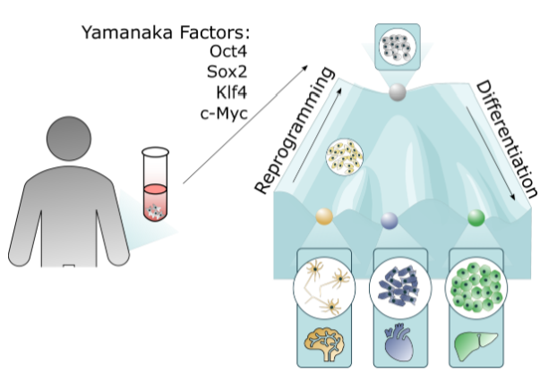
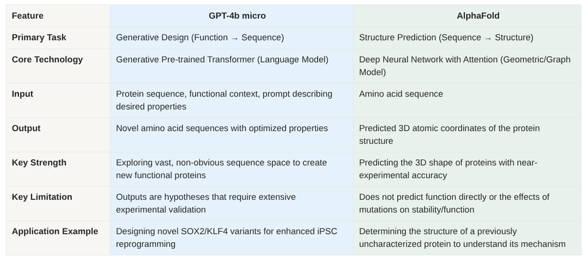
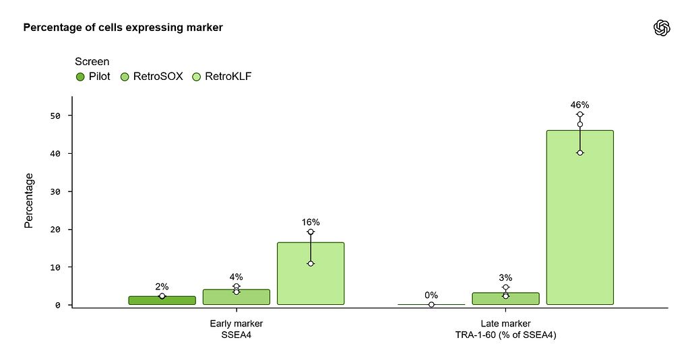
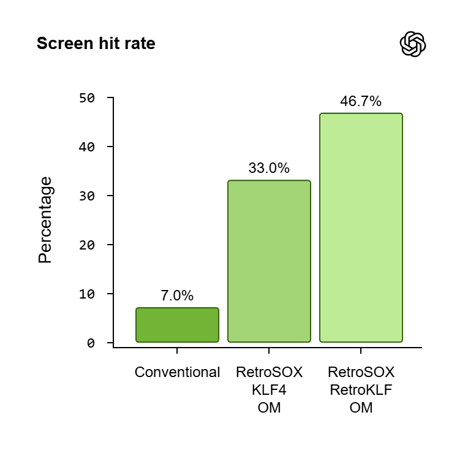
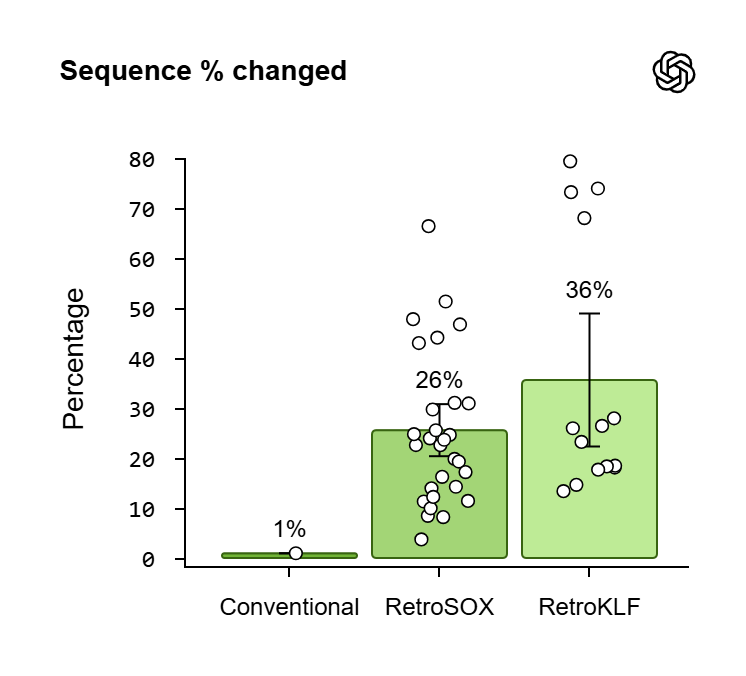
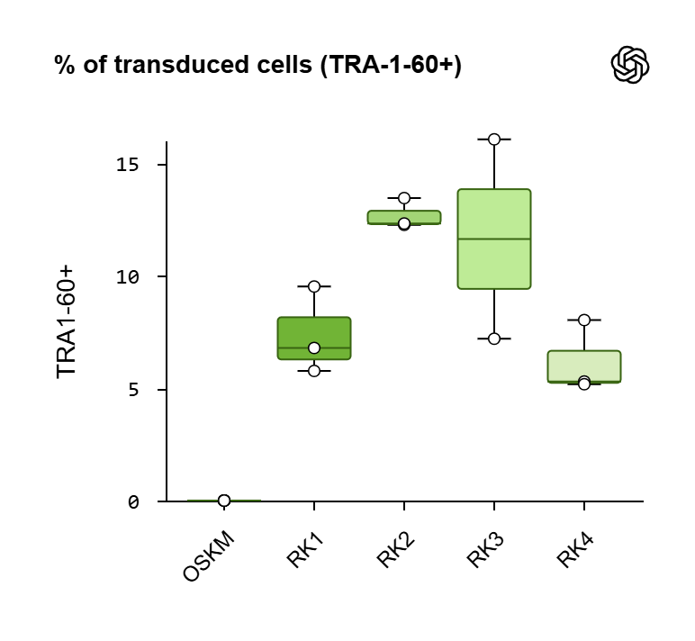
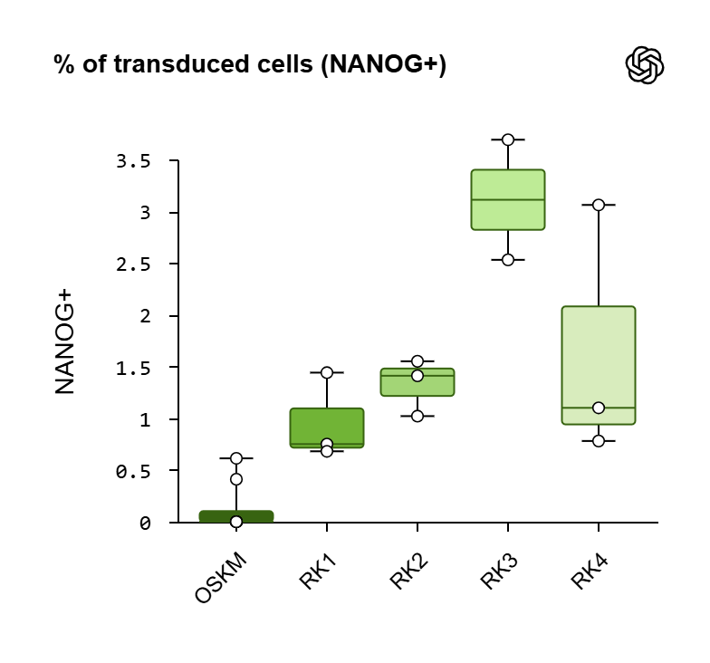
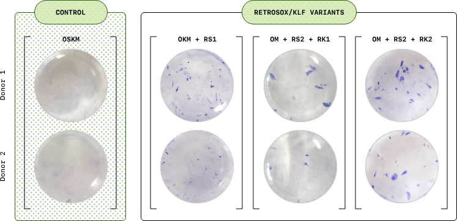
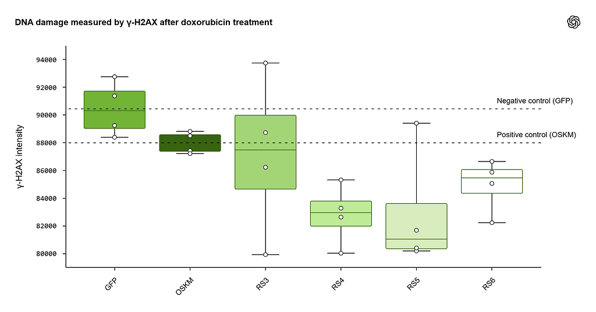



<em>Imagine a world where AI doesn’t just write your emails or generate art, it rewrites biology itself.</em>

That’s the vision behind a new collaboration between OpenAI and Retro Biosciences, where artificial intelligence is being trained not on language, but on the code of life itself. Unlike traditional language models trained on text and chat logs, this system was trained on protein sequences, 3D structural data, and chemical interaction rules (like how molecules repel, attract, or stick together).

It is a lighter version of GPT-4o designed to understand biology at the molecular level. The team put this model to the test on Yamanaka factors, a Nobel Prize-winning discovery from 2012 that showed how mature cells can be “reprogrammed” back into a stem-cell-like state. The goal wasn’t just to replicate that breakthrough, but to redesign and improve it.
<h2 id="reprogramming-cells-yamanaka-s-nobel-discovery"><strong>Reprogramming Cells: Yamanaka’s Nobel Discovery</strong></h2>
Stem cells are pluripotent, which means, they can differentiate or transform into a very specific role such as heart cells, neurons, immune cells etc. Once a stem cell “chooses” its role, it’s generally locked in for life. A skin cell can’t just decide one day to become a neuron.

What if we could simply “reprogram” adult, specialized cells back into a youthful state? In 2006, Dr. Shinya Yamanaka showed this was possible. He used just four proteins: Oct3/4, Sox2, Klf4, and c-Myc, now famously known as the Yamanaka factors (or OSKM). These proteins are transcription factors, meaning they bind to DNA and control whether certain genes are turned on or off. Remarkably, by introducing them, Yamanaka was able to reset adult cells into a stem-like state called induced pluripotent stem cells (iPSCs), which behave almost like embryonic stem cells.
<figure><figcaption>Figure 1: OKSM induced via retroviral DNA vector in iPSCs</figcaption></figure>
Why does that matter? Because pluripotent stem cells can:
<ul><li><strong>Self-renew forever </strong>(can keep on making multiple copies of themselves).</li><li><strong>Turn into any cell type</strong> in the human body.</li></ul>
This discovery opened the door to personalized medicine: growing new tissues from a patient’s own cells, organ replacement therapies and even futuristic anti-aging research, all without needing embryos.
<h2 id="the-harsh-reality-of-reprogramming-stem-cells"><strong>The Harsh reality of reprogramming stem cells</strong></h2>
While the idea is groundbreaking, the actual process is a nightmare. Even today, if you try reprogramming cells with the standard recipe, <strong>less than 1 in 1,000 cells makes it to the finish line</strong>. That’s a 0.1% conversion rate. What goes wrong? A lot:
<ul><li>The process is extremely time taking, takes <strong>weeks to months.</strong></li><li>Many cells get stuck halfway, becoming weird “in-between” states which means they are in partially reprogrammed states or undergoing senescence (death).</li><li>And if the cells are from aged donors, the cells just age out and die. A critical limitation for a technology intended to treat age-related diseases.</li></ul>
A cell’s identity is heavily guarded. Think of a skin cell as a laptop with its hard drive locked and encrypted. The Yamanaka factors are like hackers trying to wipe and reinstall the operating system but the firewalls (epigenetic marks like DNA methylation and histone locks) makes it difficult to re-program.
<figure><figcaption>Figure 2: Yamanaka factors reprogram adult cells into stem cells, enabling redifferentiation into various specialized cell types</figcaption></figure>
And that’s not the only hurdle. To truly rewind its state, the cell has to flip its metabolic switch. Mature somatic cells prefer the efficiency of oxidative phosphorylation, while reprogrammed pluripotent cells run on a glycolysis-heavy “youth mode.” This metabolic reshuffling is inherently unstable. Even worse? The process is <strong>unpredictable</strong>. Every batch of cells acts differently, which makes it almost impossible to meet the strict quality standards needed for medical use.
<h2 id="why-sox2-and-klf4-are-central-to-the-study">Why SOX2 and KLF4 are central to the study?</h2>
Among the four factors, SOX2 and KLF4 are the real MVPs. They’re the pioneer transcription factors.

Normally, DNA is wound up tightly like a locked book. Most proteins can’t even touch it unless the book is open. But SOX2 and KLF4 are special, they can crack open that locked DNA, making space for the other factors (like OCT4) to swoop in and activate the stem cell program.

What if we could tweak SOX2 and KLF4 to work better, the entire reprogramming process might become faster and more reliable. That’s what researchers at OpenAI and Retro Biosciences asked. But proteins are insanely complicated to tweak. Each is a long chain of hundreds of amino acids, and the number of possible folding combinations for a protein to work correctly.
<h2 id="gpt-4b-micro-teaching-ai-the-language-of-proteins">GPT-4b Micro: Teaching AI the Language of Proteins</h2>
This is essentially a <strong>specialized adaptation of GPT-4o</strong>, scaled down and fine-tuned for biology. Instead of learning from human text, the model is trained on massive protein databases like UniProt, which contain hundreds of millions of sequences. The model begins to capture <strong>deep contextual relationships between amino acids</strong>, almost like how a language model captures grammar and meaning in human languages.It learns not just the “what” (sequence) but also the “how” (structure), “where” (interaction network), and “why” (functions described).

One of the standout features here is the <strong>exceptionally large context window of 64,000 tokens</strong>. For protein language models (PLMs), where each token can represent a single amino acid, this scale is enormous. It means the model isn’t just limited to analyzing short fragments or local motifs; it can take in the <strong>entire protein sequence at once</strong>, along with its <strong>interaction partners</strong> and even <strong>functional annotations</strong>, all within a single pass.

This capability fundamentally changes how the model “thinks” about proteins. Instead of treating them as disjointed stretches of local patterns, the PLM can reason about the protein as a <strong>complete functional entity,</strong> capturing long-range dependencies, domain–domain interactions, and even context-dependent regulatory patterns that would be invisible to smaller models.

While GPT-4b Micro brings a new way of reasoning about proteins, it’s easy to confuse its role with existing models. The most famous example is Google’s AlphaFold. So how do they differ?
<h2 id="gpt-4b-micro-vs-alphafold-prediction-vs-generation">GPT-4b Micro vs. AlphaFold: Prediction vs. Generation</h2><ul><li>To simply put, <strong>AlphaFold is a predictive model</strong>. It brilliantly solves the “protein folding problem,” taking a linear amino acid sequence as input and predicting its complex 3D structure with experimental accuracy.</li><li><strong>GPT-4b micro is a generative model</strong>. It tackles the “protein design problem,” taking a desired function as an input (via prompting) and generating novel amino acid sequences predicted to fulfill that function.</li></ul><figure><figcaption>Table 1: Comparative Analysis of GPT-4b micro vs. AlphaFold</figcaption></figure>
Before diving into the reprogramming workflow itself, it’s important to ask: <strong>how do scientists actually know when the reprogramming has worked?</strong>
<h2 id="molecular-markers-of-pluripotency"><strong>Molecular Markers of Pluripotency</strong></h2>
The answer is in <strong>molecular markers, distinct signals that appear at different stages of the process</strong>, revealing whether a cell is truly on its way to becoming an induced pluripotent stem cell (iPSC).
<ul><li><strong>Early Markers</strong>: The appearance of <strong>SSEA-4</strong>, a surface molecule, is one of the first signs that reprogramming has begun.</li><li><strong>Late Markers</strong>: A fully reprogrammed cell is confirmed by markers such as <strong>TRA-1–60</strong> (surface antigen) and <strong>NANOG</strong> (a transcription factor essential for maintaining pluripotency).</li><li><strong>Visual Confirmation</strong>: Staining the reprogrammed cells with <strong>Alkaline Phosphatase (AP)</strong>, where pluripotent colonies light up in red or purple, providing a quick visual check of successful reprogramming.</li></ul>
Together, these markers give both <strong>molecular and visual proof</strong> that cells have crossed the threshold into pluripotency and the experiment is a success.
<h2 id="the-workflow">The Workflow</h2>
Broadly, the entire workflow can be divided into the following steps:

<strong>A. Retro’s High-Throughput Screening Engine</strong>

Computationally proteins are just hypotheses until they’re stress-tested in cells. The group at Retro Biosciences implemented a <strong>high‑throughput screening pipeline</strong> in human fibroblasts and used it to benchmark baseline OSKM alongside SOX2 variants manually designed in a pilot. This setup created a crucial <strong>feedback loop</strong>: AI proposes new protein designs, the lab rapidly tests them, and the results flow back to refine the next round of designs.

<strong>B. Designing RetroSOX and RetroKLF</strong>

The engineering process began with prompting GPT-4b micro to generate a diverse panel of SOX2 (“RetroSOX”) and KLF (”RetroKLF’) designs.
<figure><figcaption>Figure 3: This bar plot compares three screening sets: Pilot (standard OSKM/control), RetroSOX, and RetroKLFon</figcaption></figure><ul><li>Early marker (SSEA‑4): Pilot ~2–4%; RetroSOX climbs to ~16%.</li><li>Late marker (TRA‑1‑60): Pilot ~0%; RetroSOX ~3%; RetroKLF jumps dramatically to ~46%.</li></ul>
AI‑designed variants push more cells into early pluripotency and, crucially, accelerate maturation to late markers.

<strong>C. Unprecedented Hit Rates</strong>

The results generated are remarkable
<ul><li>For <strong>RetroSOX</strong>, the engineered variants of SOX2, over 30% of the designs tested showed superior performance compared to the wild-type protein in inducing pluripotency markers.</li><li>For <strong>RetroKLF</strong>, the results were even more striking, with a hit rate approaching 50%</li></ul><figure><figcaption>Figure 4: Illustrates how AI outperforms traditional methods in protein engineering. On the left, it’s about hit rates, how many designed variants outperform the natural protein</figcaption></figure><figure><figcaption>Figure 5: Reveals the scale of changes: traditional designs changes only ~1% of amino acids, but RetroSOX averages ~26% change and RetroKLF ~36%, with a spread of diverse edits shown in the scatter.</figcaption></figure>
<strong>D. What Happens When You Combine the Winners</strong>

When the top-performing RetroSOX and RetroKLF variants were combined in the reprogramming cocktail. Across multiple independent experiments, this combination led to a synergistic effect, producing a dramatic and rapid increase in the expression of both early (SSEA-4) and late-stage (TRA-1–60, NANOG) pluripotency markers. The improvement was not just in the final yield but also in the speed of the process.
<figure><figcaption>Figure 6: Increased in detection of late stage marker TRA-1–60</figcaption></figure><figure><figcaption>Figure 7: Increased in detection of late stage marker NANOG</figcaption></figure><figure><figcaption>Figure 8: Alkaline Phosphate (AP) staining validation. Purple colonies indicate successful reprogramming</figcaption></figure>
Visual confirmation through AP staining confirms these findings, revealing the formation of numerous, large, and well-defined iPSC colonies, providing clear evidence of a hyper-efficient reprogramming greater than a 50-fold higher expression of AI-engineered variants.

<strong>Maintaining DNA integrity is a core hallmark of aging</strong>

One of the main reasons cells age is the buildup of <strong>DNA damage</strong>. When DNA strands break, especially <strong>double-strand break</strong>s, the cell’s ability to function declines. A protein marker called <strong>γ-H2AX lights up at these breaks</strong>, allowing scientists to measure how much damage has occurred.

Human cells exposed to the <strong>chemotherapy drug doxorubicin </strong>(which induces DNA breaks) were reprogrammed with different factor combinations. The <strong>RetroSOX/KLF cocktail led to much lower γ-H2AX levels compared to the original Yamanaka factors (OSKM) or controls</strong>. In simple terms, these engineered factors helped cells repair their DNA more effectively.
<figure><figcaption>Figure 9: DNA damage (measured by the marker γ-H2AX) remained in cells after being stressed with the chemotherapy drug doxorubicin.</figcaption></figure><ul><li><strong>GFP (negative control)</strong>: High γ-H2AX levels, means, lots of unrepaired DNA damage.</li><li><strong>OSKM (positive control)</strong>: Slight improvement, but still elevated damage.</li><li><strong>RetroSOX/KLF variants (RS3 — RS6)</strong>: RS4 and RS5, which showed the lowest DNA damage levels, suggesting AI-engineered factors can help cells repair breaks more effectively.</li></ul><h2 id="limitation-and-the-road-ahead"><strong>Limitation and the road ahead</strong></h2>
Despite the impressive results, this is still early-stage science. Clinical stages requires Gold Standard efficiency and safety. Some of the key limitations includes:
<ul><li><strong>Scalability</strong>: High-throughput screening in fibroblasts is promising but does not yet guarantee success in large-scale manufacturing environments.</li><li><strong>Long-Term Safety</strong>: While genomic stability was confirmed in early passages, extended culture and in vivo studies are needed to rule out subtle mutations or tumorigenicity risks.</li><li><strong>Cell type dependent</strong>: Validation was performed in fibroblasts and MSCs; generalizability across other cell types remains to be established.</li><li><strong>Reproducibility</strong>: Independent replication by external labs will be necessary to strengthen confidence in the findings.</li><li><strong>Access and Transparency</strong>: The model, GPT-4b Micro, was developed internally for research and is not broadly available. <strong>The project was a collaboration between OpenAI’s research team and Retro Biosciences, in which Sam Altman is an investor</strong>.</li></ul>
if you love reading about biotech x AI, follow me on twitter/X <a href="https://x.com/TensorTwerker">@TensorTwerker</a> : I share insights on protein modeling, computational biology, and the occasional chaos that happens in my life.


